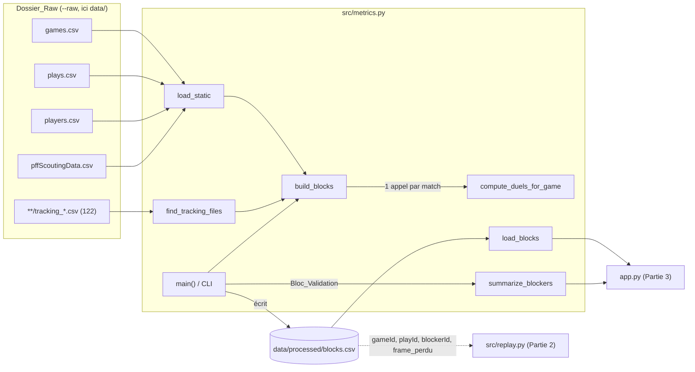
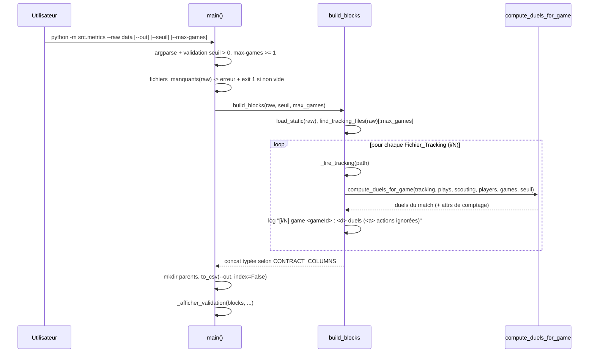
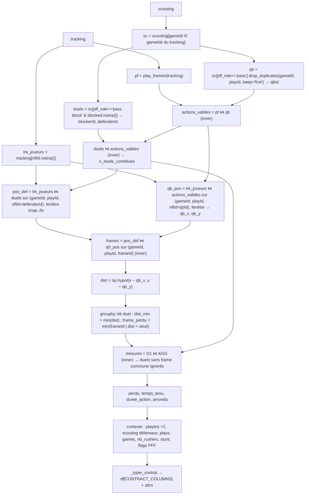

# Design Document — Weak Link · Partie 1 : Données & métrique

## Overview

La Partie 1 livre un module unique, `src/metrics.py`, qui transforme les données brutes du NFL Big Data Bowl (tracking 10 Hz + scouting PFF, 122 matchs, semaines 1 à 8 de 2021, jeux de passe) en une table de Duels bloqueur/défenseur, `data/processed/blocks.csv`, consommée par `src/replay.py` (Partie 2) et `app.py` (Partie 3).

Principe de la métrique : pour chaque Duel (ligne de scouting « pass block » avec un défenseur bloqué), on suit la Distance_Def_QB frame par frame entre la Frame_Snap et la Frame_Fin. Le Duel est perdu dès que cette distance passe strictement sous `seuil` (2.0 yards par défaut). Le temps tenu est le temps écoulé entre le snap et la perte, ou entre le snap et la fin de l'action si le Duel n'est pas perdu (Duel_Censure).

Ce design reste fidèle aux exigences : il ne renomme aucun fichier, fonction, constante ni colonne, et n'ajoute aucune fonctionnalité. Les seuls éléments ajoutés sont des fonctions et constantes privées (préfixe `_`) nécessaires à l'implémentation des fonctions publiques imposées.

### Constats issus de la lecture des données (workspace actuel)

Lecture rapide des en-têtes et de quelques effectifs, faite pour fonder le design (l'Étape 0 complète reste à faire par l'Agent, cf. section dédiée) :

- Emplacement : les 4 CSV statiques sont dans `data/`, les 122 Fichiers_Tracking dans `data/tracking/`. Pas de `data/raw/`.
- Toutes les colonnes de l'Exigence 3 existent avec la casse attendue (aucun écart de nom à signaler à ce stade).
- `players.csv` : nflId, height, weight, birthDate, collegeName, officialPosition, displayName.
- `pffScoutingData.csv` : pff_role prend les valeurs « Coverage », « Pass Block », « Pass Route », « Pass Rush », « Pass » (majuscules initiales, d'où la normalisation de l'Exigence 6). pff_blockType contient « SW » (3 025 lignes) et « NA » pour les valeurs manquantes.
- Tracking `tracking_2021090900.csv` : la valeur manquante d'event est la chaîne `None` ; les lignes du ballon ont `team == "football"` et `nflId == NA`. Events observés : ball_snap, autoevent_ballsnap, pass_forward, autoevent_passforward, qb_sack, run, play_action, line_set, pass_arrived, autoevent_passinterrupted, fumble, fumble_offense_recovered, man_in_motion, pass_outcome_caught, pass_outcome_incomplete. L'event est répété sur toutes les lignes (joueurs + ballon) d'une même frame.
- `plays.csv` : 8 557 actions ; `dropBackType` est manquant sur 528 actions et `offenseFormation` sur 7 actions ; down vaut 0 sur 35 actions ; passResult ∈ {C, I, S, R, IN}.
- Sur les lignes « Pass Block » avec défenseur bloqué (44 526), `pff_blockType` et `pff_positionLinedUp` ne sont jamais manquants.
- `pandas` n'est pas installé dans le Python système : l'environnement `.venv` (autorisé par l'Exigence 1 critère 9) doit être créé à partir de `requirements.txt` avant l'Étape 0.

### Points ouverts à trancher

1. **Valeurs manquantes de dropBackType / offenseFormation (conflit entre exigences).** L'Exigence 13 critère 4 impose de recopier ces colonnes sans transformation, alors que l'Exigence 18 critère 11 impose zéro valeur manquante hors frame_perdu, et que l'Exigence 24 critère 1 ne valide l'exécution sur 3 matchs qu'en l'absence d'avertissement de valeurs manquantes. Avec 528 actions sans dropBackType, l'avertissement apparaîtra très probablement dès 3 matchs, ce qui bloquerait l'Exigence 24 (critère 3 : boucle de correction sans fin). Design retenu par défaut (option la plus simple et fidèle à l'Exigence 13) : aucune valeur n'est inventée, l'avertissement de l'Exigence 22 critère 7 s'affiche, et cet avertissement, lorsqu'il est causé uniquement par des valeurs manquantes à la source, est traité comme l'exception déjà prévue pour l'avertissement d'anomalie (signalé dans le Rapport_Final, l'exécution sur tous les matchs se poursuit). Cette interprétation demande une confirmation de l'utilisateur ; l'alternative serait de modifier les exigences 13.4 / 18.11.
2. **Emplacement des données (Exigence 2).** Option retenue : (b) lancement avec `--raw data`. C'est l'option la plus simple, et elle ne déplace aucun fichier de données (Exigence 1 critère 11). La valeur par défaut `data/raw` reste inchangée.

## Architecture

### Vue d'ensemble des fichiers



### Couches

- **Constantes** (niveau module) : `FPS`, `SEUIL_PRESSION`, `SNAP_EVENTS`, `END_EVENTS`, `CONTRACT_COLUMNS`, plus des constantes privées : listes de colonnes lues par fichier et dictionnaire des types du contrat.
- **E/S** (lisent des fichiers) : `load_static`, `find_tracking_files` (lecture de l'arborescence seulement), `_lire_tracking`, `load_blocks`, `build_blocks`.
- **Fonctions pures** (aucune lecture/écriture de fichier, entrées non modifiées, Exigence 5 critère 12) : `play_frames`, `compute_duels_for_game`, `summarize_blockers`, et les helpers privés qu'elles appellent.
- **CLI** : `main()` (argparse, contrôle du Dossier_Raw, écriture du Fichier_Blocks, Bloc_Validation). Elle est appelée uniquement sous `if __name__ == "__main__": main()`, donc l'import du module n'a aucun effet de bord (Exigence 5 critère 11).

### Flux d'exécution de la CLI



### Décisions de design

| Décision | Choix | Justification |
|---|---|---|
| Comptage des Actions/Duels ignorés | `df.attrs` sur le résultat de `play_frames` et `compute_duels_for_game` + `logging` | Les signatures du plan restent intactes ; `attrs` est un dictionnaire de métadonnées pandas. |
| Ligne de progression | `logger.info` dans la boucle de `build_blocks` ; `main()` configure `logging.basicConfig(level=INFO, format="%(message)s", stream=sys.stdout)` | La boucle sur les matchs vit dans `build_blocks` (Exigence 17), l'affichage sur stdout est exigé par la CLI (Exigence 21 critère 3). Appelée depuis Python sans configuration de logging, `build_blocks` reste silencieuse. |
| Actions présentes dans le scouting mais absentes du tracking du match | Comptées comme « sans snap » | Aucune frame donc aucun snap trouvé ; cela garde l'invariant de l'Exigence 15 critère 4. |
| Univers des Actions d'un match | Union des (gameId, playId) du tracking et du scouting pour les gameId du tracking | Chaque Action ignorée est comptée une seule fois (Exigence 9 critère 4). |
| Jointures de contexte | `merge(how="left", validate="many_to_one")` | Interdit toute duplication de Duels (Exigence 13 critère 9) ; une clé absente laisse la colonne vide (Exigence 13 critère 10). |
| Lecture de blocks.csv | `keep_default_na=False, na_values=[""]` | Seule une cellule vide devient manquante, donc « NA »/« None » dans un texte (playDescription) restent des chaînes : aller-retour exact. |
| Type « chaîne » | dtype `object` contenant des `str` | Type par défaut de pandas pour le texte, compatible Streamlit, restitué tel quel par `read_csv(dtype=str)`. |
| Écriture des floats | `round(2)` puis `to_csv` sans `float_format` | `repr` d'un float arrondi à 2 décimales s'écrit avec au plus 2 décimales (Exigence 18 critère 6). |
| Facteur d'anomalie | littéral `1.5` commenté dans `_afficher_validation` | Exigence 22 critère 3 : valeur codée en dur, signalée en commentaire. |

## Components and Interfaces

### Constantes publiques

```python
FPS = 10                      # fréquence du tracking (1 frame = 0,1 s)
SEUIL_PRESSION = 2.0          # yards, comparaison strictement inférieure
SNAP_EVENTS = ("ball_snap", "autoevent_ballsnap")            # à confirmer à l'Étape 0
END_EVENTS = ("pass_forward", "autoevent_passforward", "pass_shovel",
              "qb_sack", "qb_strip_sack", "run")             # à confirmer à l'Étape 0
CONTRACT_COLUMNS = [ ...33 colonnes, ordre défini dans Data Models... ]
```

SNAP_EVENTS et END_EVENTS ne contiendront que les candidats du glossaire effectivement observés dans les 3 Fichiers_Tracking explorés (Exigence 4 critères 6-7). Sur le premier fichier, ball_snap, autoevent_ballsnap, pass_forward, autoevent_passforward, qb_sack et run sont observés ; pass_shovel et qb_strip_sack restent à confirmer. Le candidat « run… » du glossaire est interprété comme la seule valeur `run`. `autoevent_passinterrupted`, observé mais absent des candidats, n'est pas retenu.

### Constantes privées

| Nom | Contenu |
|---|---|
| `_COLS_GAMES` | gameId, week, homeTeamAbbr, visitorTeamAbbr |
| `_COLS_PLAYS` | gameId, playId, quarter, down, yardsToGo, possessionTeam, defensiveTeam, passResult, offenseFormation, dropBackType, pff_playAction, pff_passCoverage, playDescription |
| `_COLS_PLAYERS` | nflId, displayName, officialPosition |
| `_COLS_SCOUTING` | gameId, playId, nflId, pff_role, pff_positionLinedUp, pff_nflIdBlockedPlayer, pff_blockType, pff_hitAllowed, pff_hurryAllowed, pff_sackAllowed, pff_beatenByDefender, pff_hit, pff_hurry, pff_sack |
| `_COLS_TRACKING` | gameId, playId, nflId, frameId, x, y, event |
| `_FLAGS_PFF` | les 7 indicateurs 0/1 de l'Exigence 6 critère 4 |
| `_FICHIERS_STATIQUES` | {"games": "games.csv", "plays": "plays.csv", "players": "players.csv", "pffScoutingData": "pffScoutingData.csv"} |
| `_DTYPES_CONTRAT` | dict colonne → dtype (cf. Data Models) |
| `_COLONNES_RESUME` | les 12 colonnes de `summarize_blockers`, dans l'ordre de l'Exigence 20 critère 11 |
| `_CLE_DUEL` | ["gameId", "playId", "blockerId", "defenderId"] |

homeTeamAbbr, visitorTeamAbbr et officialPosition sont lus parce que l'Exigence 3 les impose, même si aucune colonne du contrat ne les recopie. Ils ne sont pas propagés dans la sortie.

### Fonctions publiques (signatures imposées par l'Exigence 5)

Toutes portent des annotations de type complètes et une docstring en français.

```python
def load_static(raw_dir: Path) -> dict[str, pd.DataFrame]
def find_tracking_files(raw_dir: Path) -> list[Path]
def play_frames(tracking: pd.DataFrame) -> pd.DataFrame
def compute_duels_for_game(tracking: pd.DataFrame, plays: pd.DataFrame,
                           scouting: pd.DataFrame, players: pd.DataFrame,
                           games: pd.DataFrame,
                           seuil: float = SEUIL_PRESSION) -> pd.DataFrame
def build_blocks(raw_dir: Path | str, seuil: float = SEUIL_PRESSION,
                 max_games: int | None = None) -> pd.DataFrame
def load_blocks(path: Path | str = "data/processed/blocks.csv") -> pd.DataFrame
def summarize_blockers(blocks: pd.DataFrame, min_duels: int = 20) -> pd.DataFrame
def main(argv: list[str] | None = None) -> None
```

`main` accepte un `argv` optionnel (aucun paramètre obligatoire, conforme à l'Exigence 5 critère 10) pour pouvoir être testée sans sous-processus.

#### `load_static(raw_dir)`

1. Pour chaque clé de `_FICHIERS_STATIQUES`, `pd.read_csv(raw_dir / fichier, usecols=_COLS_…)`, avec les valeurs NA par défaut de pandas (« NA » devient NaN).
2. Scouting :
   - `pff_role = pff_role.str.strip().str.lower()` (NaN conservé) ;
   - `pff_nflIdBlockedPlayer = pff_nflIdBlockedPlayer.astype("Int64")` ;
   - `scouting[_FLAGS_PFF] = scouting[_FLAGS_PFF].fillna(0).astype("int64")`.
3. L'ordre des lignes du fichier est conservé, ce qui sert la règle « premier QB » (Exigence 9 critère 2).

#### `find_tracking_files(raw_dir)`

`sorted(Path(raw_dir).glob("**/tracking_*.csv"))`. Le motif `**` de pathlib inclut la racine elle-même et toutes les profondeurs ; chaque fichier n'apparaît qu'une fois. Si la liste est vide (y compris lorsque le dossier n'existe pas, `glob` renvoyant alors une liste vide), on lève `FileNotFoundError(f"Aucun fichier tracking_*.csv trouvé sous {raw_dir}")`. Avec `Path("data")`, le premier élément vaut `data/tracking/tracking_2021090900.csv`.

#### `_lire_tracking(path) -> pd.DataFrame` (privée, E/S)

`pd.read_csv(path, usecols=_COLS_TRACKING)`, puis `event = event.str.lower()`. La chaîne `None` du fichier fait partie des valeurs NA par défaut de pandas et devient NaN. Même si elle restait la chaîne « none », elle n'appartient ni à SNAP_EVENTS ni à END_EVENTS, donc le comportement est identique (Exigence 8 critère 7). Les lignes du ballon sont conservées ici, car leur event sert à `play_frames`, et sont exclues des jointures sur nflId dans `compute_duels_for_game`.

#### `play_frames(tracking)`

Opérations vectorisées sur une copie des colonnes utiles :

1. `ev = tracking[["gameId","playId","frameId","event"]]` avec `event = event.str.lower()` sur la copie. La mise en minuscules est idempotente : elle protège les appels directs avec des données de test.
2. `snaps = ev[ev.event.isin(SNAP_EVENTS)].groupby(["gameId","playId"]).frameId.min()` → `frame_snap`.
3. `fins = ev[ev.event.isin(END_EVENTS)].merge(snaps)` filtré sur `frameId > frame_snap`, puis `groupby(...).frameId.min()` → `frame_fin_evt`.
4. `derniere = ev.groupby(["gameId","playId"]).frameId.max()`.
5. `res = snaps.merge(fins, how="left").merge(derniere)` ; `frame_fin = frame_fin_evt.fillna(derniere)`, puis cast `int64`.
6. Retour : colonnes exactement `gameId, playId, frame_snap, frame_fin`, une ligne par Action ayant un snap.
7. `res.attrs["n_actions_sans_snap"] = n_actions_tracking − len(res)`, avec un `logger.debug` du nombre.

Par construction, `frame_snap ≤ frame_fin` : soit `frame_fin > frame_snap` (étape 3), soit `frame_fin = max(frameId) ≥ frame_snap`.

#### `compute_duels_for_game(tracking, plays, scouting, players, games, seuil)` : pipeline vectorisé

Aucune boucle, compréhension, `iterrows`, `itertuples` ni `apply` ligne à ligne (Exigence 16 critère 1). Chaque étape est un filtre, un `merge`, un `groupby` ou une colonne calculée. Les DataFrames reçus ne sont jamais modifiés en place (sélections suivies de `.copy()` / `assign`).



Détail des étapes :

1. **Tracking joueurs** : `trk = tracking.loc[tracking.nflId.notna(), ["gameId","playId","nflId","frameId","x","y"]]`, nflId casté en `int64`. Les lignes du ballon sont exclues de toutes les jointures sur nflId (Exigence 6 critère 6).
2. **Fenêtres** : `pf = play_frames(tracking)`.
3. **Scouting du match** : `sc = scouting[scouting.gameId.isin(tracking.gameId.unique())]`. L'ordre du fichier est conservé.
4. **QB** : `qb = sc.loc[sc.pff_role == "pass", ["gameId","playId","nflId"]].drop_duplicates(["gameId","playId"], keep="first").rename(nflId="qbId")`.
5. **Actions valides** : `av = pf.merge(qb, on=["gameId","playId"], how="inner")`.
6. **Comptage des Actions ignorées** : `univers = concat(tracking[[gameId,playId]], sc[[gameId,playId]]).drop_duplicates()`.
   - `n_actions_sans_snap` = Actions de l'univers absentes de `pf` ;
   - `n_actions_sans_qb` = Actions de `pf` absentes de `qb` ;
   - `n_actions_ignorees = len(univers) − len(av)`, chaque Action n'étant comptée qu'une fois.
7. **Duels constitués** : `duels = sc.loc[(sc.pff_role == "pass block") & sc.pff_nflIdBlockedPlayer.notna()]`, renommage `nflId → blockerId`, `pff_nflIdBlockedPlayer → defenderId` (cast `int64`) ; on garde `pff_positionLinedUp → blockerPos`, `pff_blockType → blockType` et les flags `pff_hitAllowed, pff_hurryAllowed, pff_sackAllowed, pff_beatenByDefender`. Puis `duels = duels.merge(av, on=["gameId","playId"], how="inner")`, ce qui ajoute qbId, frame_snap et frame_fin. `n_duels_constitues = len(duels)`.
8. **Positions défenseur** : `pos_def = trk.rename(nflId="defenderId", x="x_def", y="y_def").merge(duels[[clé duel, frame_snap, frame_fin]], on=["gameId","playId","defenderId"])`, filtré sur `frame_snap ≤ frameId ≤ frame_fin`.
9. **Positions QB (`qb_pos`)** : `trk.merge(av, left_on=["gameId","playId","nflId"], right_on=["gameId","playId","qbId"])`, filtré sur la fenêtre, colonnes `gameId, playId, frameId, qb_x, qb_y`, `drop_duplicates(["gameId","playId","frameId"])` (au plus une ligne par frame, Exigence 11 critère 1).
10. **Jointure et distance** : `fr = pos_def.merge(qb_pos, on=["gameId","playId","frameId"], how="inner")`, puis `fr["dist"] = np.hypot(fr.x_def − fr.qb_x, fr.y_def − fr.qb_y)`, sans arrondi ni retournement de terrain. Seules les frames où le défenseur et le QB sont tous deux présents sont retenues (Exigence 15 critère 3).
11. **Agrégats** :
    - `agg = fr.groupby(_CLE_DUEL).dist.min().rename("dist_min")` ;
    - `perte = fr[fr.dist < seuil].groupby(_CLE_DUEL).frameId.min().rename("frame_perdu")` ;
    - `agg = agg.reset_index().merge(perte.reset_index(), how="left")`.
12. **Duels mesurés** : `m = duels.merge(agg, on=_CLE_DUEL, how="inner")`. Un Duel sans aucune frame commune défenseur+QB disparaît ici (défenseur absent : Exigence 15 critère 1 ; QB absent : Exigence 15 critère 2, ce qui retire tous les Duels de l'Action). `n_duels_ignores = n_duels_constitues − len(m)`.
13. **Métrique** :
    - `perdu = frame_perdu.notna()`, qui équivaut à `dist_min_brut < seuil` (Exigence 11 critère 9) ;
    - `frame_perdu` casté en `Int64` ;
    - `duree_action = (frame_fin − frame_snap) / FPS` ;
    - `temps_tenu = (frame_perdu.fillna(frame_fin) − frame_snap) / FPS` ;
    - arrondi à 2 décimales de temps_tenu, duree_action et dist_min, appliqué après le calcul de perdu (Exigence 12 critère 4).
14. **Indicateurs PFF** : `pressure_allowed = (hitAllowed == 1) | (hurryAllowed == 1) | (sackAllowed == 1)`, `sack_allowed = sackAllowed == 1`, `beaten_by_defender = beatenByDefender == 1`. Les NaN valent déjà 0 depuis `load_static` ; un `fillna(0)` local protège les appels directs. Ces colonnes ne dépendent ni de `seuil` ni de `perdu`.
15. **Contexte** (jointures left, `validate="many_to_one"`) :
    - `players[nflId, displayName]` sur blockerId → `blockerName`, puis sur defenderId → `defenderName` ;
    - `sc[gameId, playId, nflId, pff_positionLinedUp]` sur (gameId, playId, defenderId) → `defenderPos` ;
    - `plays` sur (gameId, playId) : `possessionTeam → team`, `defensiveTeam → defenseTeam`, et quarter, down, yardsToGo, passResult, offenseFormation, dropBackType, pff_playAction, pff_passCoverage, playDescription non transformés (sauf `pff_playAction == 1` → booléen, Exigence 18 critère 7) ;
    - `games[gameId, week]` sur gameId ;
    - `nb_rushers` : `sc[pff_role == "pass rush"].groupby([gameId, playId]).size()`, jointure left, `fillna(0)` puis `int64` ;
    - `stunt` : `sc.assign(sw=sc.pff_blockType.eq("SW")).groupby([gameId, playId]).sw.any()`, jointure left, `fillna(False)`. Une valeur NaN n'est pas égale à « SW ».
16. **Sortie** : `res = _typer_contrat(m)[CONTRACT_COLUMNS]` avec `res.attrs = {"n_actions_ignorees", "n_actions_sans_snap", "n_actions_sans_qb", "n_duels_constitues", "n_duels_ignores"}`.

Si aucune Action n'est valide, le pipeline produit naturellement un DataFrame à 0 ligne. `_typer_contrat` garantit alors les 33 colonnes typées, sans exception (Exigence 23 critère 4).

#### `_typer_contrat(df) -> pd.DataFrame` (privée, pure)

Ajoute les colonnes de CONTRACT_COLUMNS éventuellement absentes (cas vide), puis applique `df.astype(_DTYPES_CONTRAT)` et réordonne selon CONTRACT_COLUMNS. Si une colonne entière non nullable contient une valeur manquante, ce qui ne peut arriver que si une clé de contexte est absente (week, quarter, down, yardsToGo), `astype("int64")` échouerait. Pour ces seules colonnes de contexte, le repli est `Int64` (respectivement `boolean` pour pff_playAction), et l'avertissement de l'Exigence 22 critère 7 signale le cas. Les colonnes gameId, playId, blockerId, defenderId, frame_snap, frame_fin et nb_rushers ne peuvent pas être manquantes par construction.

#### `build_blocks(raw_dir, seuil, max_games)`

1. `raw_dir = Path(raw_dir)`, `static = load_static(raw_dir)`, `fichiers = find_tracking_files(raw_dir)` (l'erreur est propagée si la liste est vide).
2. `if max_games is not None: fichiers = fichiers[:max_games]`, qui traite min(max_games, N) fichiers.
3. Boucle sur les fichiers, seule boucle autorisée (Exigence 16 critère 1) : `trk = _lire_tracking(f)`, `res = compute_duels_for_game(trk, static["plays"], static["pffScoutingData"], static["players"], static["games"], seuil=seuil)`, puis `logger.info(f"[{i}/{N}] game {gameId} : {len(res)} duels ({res.attrs['n_actions_ignorees']} actions ignorées)")`, où `gameId = f.stem.removeprefix("tracking_")`.
4. `blocks = _typer_contrat(pd.concat(resultats, ignore_index=True))`, retypé parce que `concat` peut élargir les types. `blocks.attrs` reçoit les totaux et `n_matchs`.

#### `load_blocks(path)`

1. `path = Path(path)`. Si le fichier n'existe pas : `FileNotFoundError(f"Fichier introuvable : {path}")`, sans création de fichier.
2. `pd.read_csv(path, dtype=_DTYPES_LECTURE, keep_default_na=False, na_values=[""])`. `_DTYPES_LECTURE` est dérivé de `_DTYPES_CONTRAT` : `bool` pour les 6 booléens, `int64`, `Int64`, `float64`, `str` pour les chaînes.
3. Retour : `df[CONTRACT_COLUMNS]`. Un fichier réduit à l'en-tête donne 0 ligne avec les bons types.

#### `summarize_blockers(blocks, min_duels)`

Vectorisé, sur la table reçue, éventuellement déjà filtrée (Exigence 20 critère 7) :

1. Si `blocks` est vide : retour `pd.DataFrame(columns=_COLONNES_RESUME)`.
2. `cles = ["team","blockerId","blockerName"]` ; `g = blocks.groupby(cles, as_index=False).agg(n_duels=("perdu","size"), n_perdus=("perdu","sum"), temps_tenu_moyen=("temps_tenu","mean"), pressions_accordees=("pressure_allowed","sum"), sacks_accordes=("sack_allowed","sum"))`.
3. Médiane des seuls Duels perdus : `blocks[blocks.perdu].groupby(cles).temps_tenu.median().rename("temps_avant_defaite_median")`, jointure left (NaN si aucun Duel perdu).
4. `blockerPos` modal avec départage alphabétique : `blocks.groupby(cles + ["blockerPos"]).size()`, puis tri par (cles, effectif décroissant, blockerPos croissant), puis `drop_duplicates(cles, keep="first")`, puis jointure.
5. `taux_perdu = n_perdus / n_duels`, `taux_pression = pressions_accordees / n_duels`.
6. Filtre `n_duels >= min_duels`, tri `sort_values(["taux_perdu","taux_pression"], ascending=False, kind="mergesort")`, `reset_index(drop=True)`, colonnes dans l'ordre `_COLONNES_RESUME`. Un résultat vide garde ces colonnes.

#### `main(argv=None)` : CLI

- `argparse.ArgumentParser(prog="python -m src.metrics")` avec :
  - `--raw` (Path, défaut `data/raw`) ;
  - `--out` (Path, défaut `data/processed/blocks.csv`) ;
  - `--seuil` (`type=_float_strictement_positif`, défaut SEUIL_PRESSION) ;
  - `--max-games` (`type=_entier_au_moins_1`, défaut None).
- Les deux convertisseurs lèvent `argparse.ArgumentTypeError`. argparse affiche alors `argument --seuil: …` (nom de l'argument) et sort avec le code 2, avant toute écriture (Exigence 21 critère 8). Les valeurs `nan` et `inf` sont refusées pour `--seuil`.
- `manquants = _fichiers_manquants(raw)` : si la liste n'est pas vide, on affiche sur stderr le chemin recherché, chaque fichier manquant et l'astuce `--raw data`, puis `sys.exit(1)` (Exigence 2 critères 3-4).
- Configuration du logging (stdout, `%(message)s`, INFO), `t0 = time.perf_counter()`, `blocks = build_blocks(raw, seuil, max_games)`.
- `out.parent.mkdir(parents=True, exist_ok=True)`, puis `blocks.to_csv(out, index=False)`, qui écrase le fichier existant.
- `_afficher_validation(blocks, seuil=seuil, n_matchs=…, duree_s=time.perf_counter() − t0)`.

#### `_afficher_validation(blocks, seuil, n_matchs, duree_s)` : Bloc_Validation

Affiche dans cet ordre, avec `print` :

1. En-tête : nombre de matchs traités, seuil utilisé et temps écoulé en secondes. Ces valeurs sont nécessaires pour la section « Résultats de validation » de Doc_Metriques (Exigence 25 critère 8).
2. Nombre d'Actions (`blocks[["gameId","playId"]].drop_duplicates()`), nombre de Duels, pourcentage de Duels perdus (1 décimale) et temps tenu médian (2 décimales), ou « non disponible » si 0 Duel.
3. `pd.crosstab(blocks.perdu, blocks.pressure_allowed).reindex(index=[True, False], columns=[True, False], fill_value=0)`.
4. Contrôle d'anomalie : si l'un des deux groupes pressure_allowed est vide, on affiche l'avertissement « comparaison impossible » (Exigence 22 critère 4). Sinon, si `taux_T <= 1.5 * taux_F` (facteur 1,5 codé en dur, commenté), on affiche l'avertissement d'anomalie probable avec les deux taux.
5. Top 10 de `summarize_blockers(blocks, min_duels=20).head(10)`, ou un message si le résultat est vide.
6. `blocks[CONTRACT_COLUMNS].isna().sum()` pour les 33 colonnes, puis un avertissement par colonne autre que frame_perdu dont le compte est supérieur à 0.

Les avertissements n'interrompent rien : le fichier est déjà écrit avant l'affichage du bloc.

### Étape 0 : exploration (script jetable, non livré)

Une fois `requirements.txt` créé et `.venv` installé, l'exploration est exécutée par `python - <<'EOF' … EOF` (code passé sur l'entrée standard, aucun fichier créé dans le dépôt). Si un fichier temporaire s'avère plus pratique, il est placé hors du dépôt (`/tmp/explore_weaklink.py`) puis supprimé. L'exploration affiche :

1. Les fichiers de `data/` et `data/tracking/`, et le nombre de `tracking_*.csv` (attendu : 122).
2. Pour les 4 CSV statiques : `shape`, `list(columns)`, `head(3)`.
3. `value_counts(dropna=False)` de pff_role et pff_blockType.
4. `value_counts(dropna=False)` de event sur 3 Fichiers_Tracking distincts (le premier, un du milieu et le dernier de la liste triée).
5. Le nombre de (gameId, playId) distincts du scouting, le nombre de ceux absents de plays.csv, et, pour les 3 gameId explorés, le nombre de ceux absents des Fichiers_Tracking correspondants.

Les résultats fixent SNAP_EVENTS et END_EVENTS avant l'écriture du code de calcul. Les écarts éventuels de colonnes sont notés pour le Rapport_Final.

## Data Models

### Entrées (après chargement)

| Table | Clé | Colonnes et types après `load_static` / `_lire_tracking` |
|---|---|---|
| games | gameId | gameId int64, week int64, homeTeamAbbr str, visitorTeamAbbr str |
| plays | (gameId, playId) | gameId, playId, quarter, down, yardsToGo int64 ; possessionTeam, defensiveTeam, passResult, offenseFormation, dropBackType, pff_passCoverage, playDescription str/NaN ; pff_playAction int64 (0/1) |
| players | nflId | nflId int64, displayName str, officialPosition str |
| scouting | (gameId, playId, nflId) | pff_role str normalisé (minuscules, sans espaces de bord) ; pff_positionLinedUp, pff_blockType str/NaN ; pff_nflIdBlockedPlayer Int64 ; 7 flags PFF int64 0/1 sans NaN |
| tracking | (gameId, playId, nflId, frameId) | gameId, playId, frameId int64 ; nflId float (NaN pour le ballon) ; x, y float64 ; event str minuscules / NaN |

### Tables intermédiaires de `compute_duels_for_game`

| Table | Granularité | Colonnes |
|---|---|---|
| `pf` (play_frames) | 1 ligne / Action avec snap | gameId, playId, frame_snap int64, frame_fin int64 ; attrs `n_actions_sans_snap` |
| `qb` | 1 ligne / Action avec QB | gameId, playId, qbId |
| `av` (actions valides) | 1 ligne / Action avec snap et QB | gameId, playId, frame_snap, frame_fin, qbId |
| `duels` | 1 ligne / Duel constitué | gameId, playId, blockerId, defenderId, blockerPos, blockType, 4 flags PFF, frame_snap, frame_fin, qbId |
| `pos_def` | 1 ligne / (Duel, frame de la fenêtre) | clé Duel, frameId, x_def, y_def |
| `qb_pos` | ≤ 1 ligne / (gameId, playId, frameId) | gameId, playId, frameId, qb_x, qb_y |
| `fr` | 1 ligne / (Duel, frame commune) | clé Duel, frameId, dist |
| `agg` | 1 ligne / Duel mesuré | clé Duel, dist_min (brut), frame_perdu (NaN si non perdu) |

### Sortie : `CONTRACT_COLUMNS` (ordre exact du Fichier_Blocks)

Les 20 colonnes obligatoires (Exigence 18 critère 2) puis les 13 additionnelles (critère 3), dans l'ordre où les exigences les citent :

| # | Colonne | dtype pandas | Source / calcul |
|---|---|---|---|
| 1 | gameId | int64 | scouting |
| 2 | playId | int64 | scouting |
| 3 | blockerId | int64 | scouting nflId (pass block) |
| 4 | blockerName | str | players.displayName |
| 5 | blockerPos | str | scouting pff_positionLinedUp du bloqueur |
| 6 | team | str | plays.possessionTeam |
| 7 | defenderId | int64 | scouting pff_nflIdBlockedPlayer |
| 8 | defenderName | str | players.displayName |
| 9 | temps_tenu | float64 (2 déc.) | secondes |
| 10 | perdu | bool | frame_perdu renseigné |
| 11 | pressure_allowed | bool | hit/hurry/sack allowed |
| 12 | sack_allowed | bool | pff_sackAllowed == 1 |
| 13 | down | int64 | plays |
| 14 | yardsToGo | int64 | plays |
| 15 | nb_rushers | int64 | nombre de « pass rush » de l'Action |
| 16 | stunt | bool | au moins un pff_blockType == "SW" dans l'Action |
| 17 | pff_playAction | bool | plays (1 → True) |
| 18 | offenseFormation | str | plays |
| 19 | passResult | str | plays |
| 20 | playDescription | str | plays |
| 21 | week | int64 | games |
| 22 | quarter | int64 | plays |
| 23 | defenseTeam | str | plays.defensiveTeam |
| 24 | defenderPos | str | scouting pff_positionLinedUp du défenseur |
| 25 | blockType | str | scouting pff_blockType du bloqueur |
| 26 | beaten_by_defender | bool | pff_beatenByDefender == 1 |
| 27 | frame_snap | int64 | play_frames |
| 28 | frame_fin | int64 | play_frames |
| 29 | frame_perdu | Int64 (nullable) | première frame avec dist < seuil |
| 30 | duree_action | float64 (2 déc.) | secondes |
| 31 | dist_min | float64 (2 déc.) | yards |
| 32 | dropBackType | str | plays |
| 33 | pff_passCoverage | str | plays |

Invariants de la table :

- clé unique (gameId, playId, blockerId, defenderId) ;
- `frame_snap ≤ frame_fin` ;
- `perdu ⇔ frame_perdu non vide`, et `frame_snap ≤ frame_perdu ≤ frame_fin` lorsque renseigné ;
- `0 ≤ temps_tenu ≤ duree_action` ;
- `temps_tenu == duree_action` lorsque perdu = False ;
- team, duree_action, nb_rushers et stunt constants au sein d'une Action.

### Sortie de `summarize_blockers`

| Colonne | Type | Calcul |
|---|---|---|
| team, blockerId, blockerName | str, int64, str | clé de regroupement |
| blockerPos | str | valeur la plus fréquente, départage alphabétique |
| n_duels | int64 | nombre de Duels |
| n_perdus | int64 | somme de perdu |
| taux_perdu | float64 | n_perdus / n_duels |
| temps_tenu_moyen | float64 | moyenne de temps_tenu (tous Duels) |
| temps_avant_defaite_median | float64 | médiane de temps_tenu des Duels perdus, NaN sinon |
| pressions_accordees | int64 | somme de pressure_allowed |
| taux_pression | float64 | pressions_accordees / n_duels |
| sacks_accordes | int64 | somme de sack_allowed |

Filtre `n_duels ≥ min_duels` (défaut 20), tri par taux_perdu décroissant puis taux_pression décroissant.
